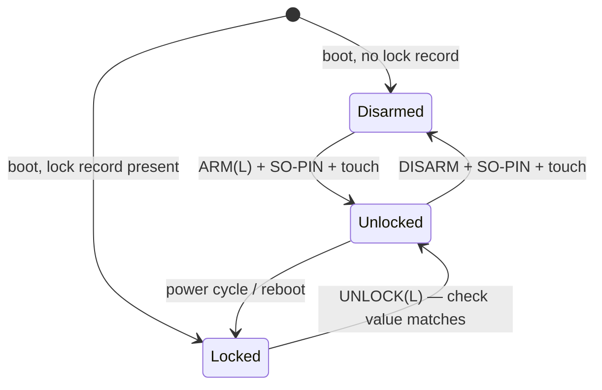

# HSM image — design

The RS-Key security key ships one image family; this adds a second: an **HSM
image** built from the same tree, for a homelab server that wants a key store
behind PKCS#11 — LUKS unlock through `systemd-cryptenroll --pkcs11-token-uri`,
SSH host and CA keys, a small internal TLS CA. The security-key image is
untouched by it: same crates, same bring-up, a cargo feature apart.

This page is the design record the implementation was built against. What a user
needs is in [guides/hsm.md](guides/hsm.md); what it does not defend against is in
the [threat model](threat-model.md#the-hsm-image) and
[limitations](limitations.md#hsm-image).

## Protocol: a SmartCard-HSM-compatible subset — viable

OpenSC ships a built-in driver for the CardContact SmartCard-HSM (`sc-hsm`,
`card-sc-hsm.c` + `pkcs15-sc-hsm.c`), so a device that answers that APDU surface
is a PKCS#11 token through `opensc-pkcs11.so` with no custom driver. Checked
against the OpenSC sources before any code was written:

- **Matching does not need a borrowed ATR.** For an unknown ATR the driver SELECTs
  AID `E8 2B 06 01 04 01 81 C3 1F 02 01` and accepts the card when the FCP carries
  a proprietary tag `85` of at least two bytes. The HSM image keeps the RS-Key ATR.
- **Everything PKCS#11 needs maps onto a small command set**: SELECT, ENUMERATE
  OBJECTS, READ/UPDATE BINARY (odd INS), DELETE FILE, VERIFY / CHANGE / RESET
  RETRY COUNTER, INITIALIZE, GENERATE KEY PAIR, SIGN, DECIPHER. OpenSC pads RSA
  PKCS#1 v1.5 and strips decryption padding in software (the driver does not
  advertise card-side PKCS#1), hashes for ECDSA, and reads the token serial out of
  the device certificate's holder reference.
- **Two things it requires that a naïve card would not have**: a decodable device
  CV certificate in `EF 2F02` (the PKCS#15 bind fails without it), and generated
  keys answered as a CV certificate request whose public key carries the full EC
  domain parameters (OpenSC identifies the curve by `p` and `a`).
- **What it cannot reach**: EdDSA (the driver registers RSA and ECDSA only), AES
  keys (no secret-key objects for this driver), key domains beyond the default,
  public-key authentication, secure messaging. Those are out of the subset; AES
  and the DKEK functions stay reachable through `rsk hsm` and raw APDUs.

So the alternative — a custom PKCS#11 module or an OpenSC patch — is not needed.

## Crates

| Crate | Role in the HSM image |
|---|---|
| `rsk-sdk` | APDU parsing (short + extended), `Dispatcher` (SELECT, chaining, `61xx`), BER-TLV, status words, `Rng` / `UserPresence` seams — unchanged |
| `rsk-usb` | the CCID transport and its WTX streaming during long keygens — unchanged |
| `rsk-fs`, `rsk-store` | the flash KV store; the HSM owns a disjoint FID range — unchanged |
| `rsk-crypto` | SHA/HMAC/HKDF, AES-GCM/CBC/ECB, ChaCha20-Poly1305, the device root `Device::derive_kbase` (OTP-rooted once provisioned), `ct_eq` — unchanged |
| `rsk-ec` | EC keys, deterministic ECDSA, ECDH; gains one additive function, `ecdh_point` (the SmartCard-HSM answers ECDH with the full point) |
| `rsk-rsa` | RSA keygen (and the dual-core prime search hook), the CRT blob, the blinded + fault-checked private op — unchanged |
| `rsk-rescue`, `rsk-vendor`, `rsk-phy`, `rsk-led` | provisioning, OTP fuse writes, secure-boot status, LED, reboot, USB identity — unchanged |
| **`rsk-hsm`** (new) | the HSM applet: the APDU subset, the file system mapping, PINs, the lock state machine, the sealed key store, CVC encoding, DKEK backup. `no_std`, host-tested, fuzzed |
| `rsk-device` | gains `HsmApplets`, the HSM image's CCID wiring (vendor + HSM + rescue) with the same dual-core RSA keygen fast path the PIV/OpenPGP wiring has, and `hsm_boot`, its boot pass. Unconditional: only the HSM image instantiates them, so the key image links none of it |
| `firmware` | gains the `hsm` feature, built the way `display` is: the same board bring-up (LED, presence, flash, OTP, core1) composes a CCID-only device and an HSM worker (`hsm_worker.rs`) instead of the key's transports and worker, which the feature compiles out. Without it the key image is the same code |
| `tools/emu` | `--hsm` runs the HSM applet set; `--vpcd` attaches it to `pcscd` as a virtual reader, which is how OpenSC is tested with no board |
| `tools/rsk` | `rsk hsm …`: status, lock arm/unlock/disarm, DKEK shares (SLIP-39 n-of-m), attestation check |

No applet names another applet: `rsk-hsm` is wired by `rsk-device` (and by the
emulator and the fuzzer for their own harnesses; `deny.toml` R2). The device
attestation key lives in `rsk-rescue`, so the HSM reaches it through a seam the
wiring fills — the `rsk_hsm::RootSign` closure `rsk_hsm::provision` signs with —
not through a dependency.

## Command subset

`CLA 00` unless shown as `80`. Access conditions are checked in this order, and the
first failing one answers: initialized → lock open → user PIN verified → per-key
algorithm list → touch (option `0x0100`).

| Command | APDU | Notes | Access |
|---|---|---|---|
| SELECT | `A4 04 0x` AID | FCP `62 { 82 38, 85 opt‖FF‖ver }`; ends the login session | always |
| SELECT EF | `A4 00/02 0x` FID | FCP `62 { 80 size, 82 01, 83 fid }`; `3F00` is the applet | always |
| ENUMERATE OBJECTS | `80 58 00 00` | every live FID, two bytes each | always |
| READ BINARY | `B0` / `B1` (`54 02` offset) | current EF or FID in P1P2; `6282` at end of file | public EFs always; `CDxx` user PIN; keys never |
| UPDATE BINARY | `D7` FID (`54 02` offset, `53` data) | creates the EF; `2F10` is the unwrap staging file | user PIN |
| DELETE FILE | `E4 02 00` FID | a key FID deletes the key | user PIN |
| VERIFY | `20 00 81` | no data → `9000` / `63Cx` / `6983` / `6A88`; `88` status only; `85`/`86` → `6A88` | lock open (data form) |
| CHANGE REFERENCE DATA | `24 00 81` old‖new, `24 00 88` old(8)‖new(8) | | lock open |
| RESET RETRY COUNTER | `2C 00 81` SO‖new, `2C 01 81` SO | needs option `0001` (RRC); `0020` refuses `P1=00` | lock open |
| INITIALIZE DEVICE | `80 50 00 00` TLV `80 81 82 91 92` | re-init needs the SO-PIN and wipes every key; `93`/`95`/`96`/`97` refused | SO-PIN once initialized |
| MANAGE KEY DOMAIN | `80 52 00 00` [share] | DKEK share import / status, default domain only | lock open |
| GENERATE KEY PAIR | `46` kid `00` CVC template | EC P-256/P-384/P-521/secp256k1, RSA 2048/3072/4096; answers an authenticated CVC request | user PIN |
| GENERATE SYMMETRIC KEY | `48` kid `B0/B1/B2` | AES-128/192/256 | user PIN |
| SIGN | `80 68` kid algo | RSA `20` raw, `30`–`35` PKCS#1, `40`–`45` PSS; ECDSA `70`–`75` (DER) | user PIN |
| DECIPHER | `80 62` kid algo | RSA `21` raw; ECDH `80` → `04‖X‖Y` | user PIN |
| CIPHER SYMMETRIC | `80 78` kid algo | AES-CBC `10`/`11` (zero IV), CMAC `18` | user PIN |
| WRAP / UNWRAP KEY | `80 72` kid `92` / `80 74` kid `93` | SmartCard-HSM key blob under the DKEK | user PIN, complete DKEK |
| GET CHALLENGE | `84 00 00` | ≤ 1024 bytes | always |
| LOCK (RS-Key) | `80 E8` P1 | `00` status, `01` channel, `02` unlock, `03` arm, `04` disarm | see below |

Refused outright, with a status word rather than silence: RSA below 2048,
P-192/P-224, brainpool (flash), EdDSA, PKA, transport/session/bio PINs, secure
messaging, key domains other than the default.

## Key store and sealing

Records live in `rsk-fs` under an HSM-only FID range (`0xA0xx`–`0xA8xx`), so
images that never had the HSM read nothing of it and a reflash between images
leaves both sides intact. SmartCard-HSM FIDs are translated, never stored as-is:

| SmartCard-HSM | Holds | `rsk-fs` FID | At rest |
|---|---|---|---|
| — | state: initialized, options, PIN lengths and retry limits, DKEK share count + KCV | `A000` | plain |
| — | SO-PIN verifier, retry counters | `A001`, `A002` | plain (verifier is kbase-keyed) |
| — | `ENV_DEV`, `ENV_USER`, `ENV_SO`, `ENV_DKEK` | `A003`–`A006` | sealed (below) |
| — | lock record: factor, parameters, check value | `A007` | plain (check value is DK-keyed) |
| `CC00` | device authentication key | `A008` | sealed under kbase |
| `2F02` / `2F03` / `2F10` | device certificate / token info / unwrap staging | `A009`–`A00B` | plain |
| `CCxx` | key objects (type, metadata, material) | `A1xx` | sealed under HMK |
| `C4xx` `C8xx` `C9xx` `CAxx` `CExx` `CFxx` | PRKD, CD, DCOD, CA certs, EE certs/CSRs, public data | `A2xx` … `A8xx` | plain |
| `CDxx` | PIN-protected data objects | `A6xx` | sealed under HMK |

Three keys, three layers, each answering one question:

- **DK — "is this the device, and is the lock open?"** A random 32-byte key,
  stored as `ENV_DEV = AES-256-GCM(K_dev, DK)` with
  `K_dev = HKDF(serial_hash, kbase ‖ L)` — `L` present only while armed. `kbase`
  is the existing device root, so DK inherits the OTP-burn story of every other
  sealed record.
- **HMK — "is the PIN right?"** A random 32-byte master key, stored twice:
  `ENV_USER` and `ENV_SO` under `HMAC-SHA256(DK, label ‖ ref ‖ PIN)`. The AEAD tag
  *is* the user-PIN check — there is no separate user verifier a flash dump could
  brute-force without DK. The SO-PIN additionally has a kbase-keyed verifier so a
  locked device can still be re-initialized (wiped) by its SO.
- **Key objects** are `AES-256-GCM` under `HKDF(HMK, fid)`, AAD = FID ‖ format, so
  a blob moved to another FID does not open. The use counter and the allowed
  algorithm list live inside the sealed blob, where a flash writer cannot edit
  them; a counter decrement is persisted *before* the operation runs.

The DKEK accumulator is sealed under DK, not HMK, because `sc-hsm-tool` imports
shares without a login. Export is only ever the SmartCard-HSM wrap format
(`KCV ‖ type ‖ OIDs ‖ AES-256-CBC(K_enc) ‖ CMAC(K_mac)`, `K_enc`/`K_mac` =
`SHA-256(DKEK ‖ 1|2)`), so a key never leaves in plaintext and backups made here
restore on any device that speaks the format.

When the OTP master key is burned after initialization, `ENV_DEV` and the device
key are re-sealed at boot (`rsk_hsm::migrate_seal`, armed devices at their next
unlock), the SO verifier at the SO-PIN's next use; each re-seal re-arms the
one-shot at-rest scrub first, like every other migration in the tree.

## PIN and lock state machine

RAM state, rebuilt on every power-up: `lock ∈ {Disarmed, Locked, Unlocked(L)}`
and `session ∈ {None, User(HMK)}`.

- **Locked** answers `6985` to every command that needs DK — VERIFY with data,
  CHANGE, RESET RETRY COUNTER, key generation and use, share import — without
  spending a PIN try. Public reads, SELECT, ENUMERATE, status and a SO-PIN
  re-initialize still work: none needs a secret.
- **VERIFY** spends the try *first* (persisted), then opens `ENV_USER`; success
  restores the counter and holds HMK for the session. A flash read that fails is
  `6581` and spends nothing: a fault is not a wrong PIN.
- **The session ends** on SELECT of the applet (OpenSC's logout), a card reset, a
  power cycle and a reboot, and HMK is zeroized with it.
- **The unlock secret is a seam, not a source.** `HsmApplet::unlock(secret)` checks
  32 bytes against the record and does not ask where they came from. The record
  carries a factor id: `1` = host-delivered key (shipped: the host sends `L` over an
  ephemeral P-256 ECDH → HKDF → ChaCha20-Poly1305 channel, as the soft-lock does),
  `2` = FIDO2 `hmac-secret` from a token on the board's PIO USB-A port (reserved —
  refused at ARM in this build). That milestone adds a USB host task that derives
  the 32 bytes from the token and calls the same `unlock`; the key store, the
  record format and this state machine do not change.

## Image, boards, flavors

`cargo build --release -p firmware --features hsm`. One USB
interface (CCID), product string `RS-Key HSM`, the RS-Key VID:PID and ATR, the
same partition table, secure-boot and OTP story as the key. Flavors: `hsm` (4 MB),
`hsm-2mb` (`FLASH_SIZE=2M KVMAIN=896K`, Waveshare RP2350-USB-A), `hsm-16mb`
(TenStar RP2350-USB). A `waveshare-usb-a` board preset documents the board (WS2812
on GPIO16, GPIO12/13 reserved for the USB-A port).

## Flash budget

The HSM image drops FIDO2 (CBOR, ML-DSA, ML-KEM), OpenPGP, PIV, OATH, OTP and
the management applet, and adds the HSM applet. The brainpool and Edwards
curves stay linked: the EC layer's key type spans every curve, and its match arms
keep them reachable. Measured on the 2 MB geometry the image is **580 KiB** of
the 1024 KiB code region — over the "under half" this design set itself, still
444 KiB clear for the USB-A host milestone. The check.sh ratchet holds the
measured figure ([build.md](build.md#the-hsm-image)).

## Milestones

1. **Core** — `rsk-hsm`: files, INITIALIZE, PINs, the lock, the sealed store.
2. **Asymmetric keys** — EC/RSA keygen, SIGN, DECIPHER/ECDH, CVC, device attestation.
3. **Backup** — AES keys, DKEK shares, WRAP/UNWRAP.
4. **Image** — `rsk-device` wiring, the firmware `hsm` feature, boards, nix flavors, gate rows.
5. **Emulator and tests** — `--hsm`, `--vpcd`, `tests/86_hsm.py`, fuzz targets.
6. **Interop** — OpenSC `pkcs11-tool` and LUKS enrollment, scripted.
7. **Host tool** — `rsk hsm`.
8. **Docs** — guide, threat model, limitations, CHANGELOG.

Each lands as its own commit with the gate rows that cover it.
